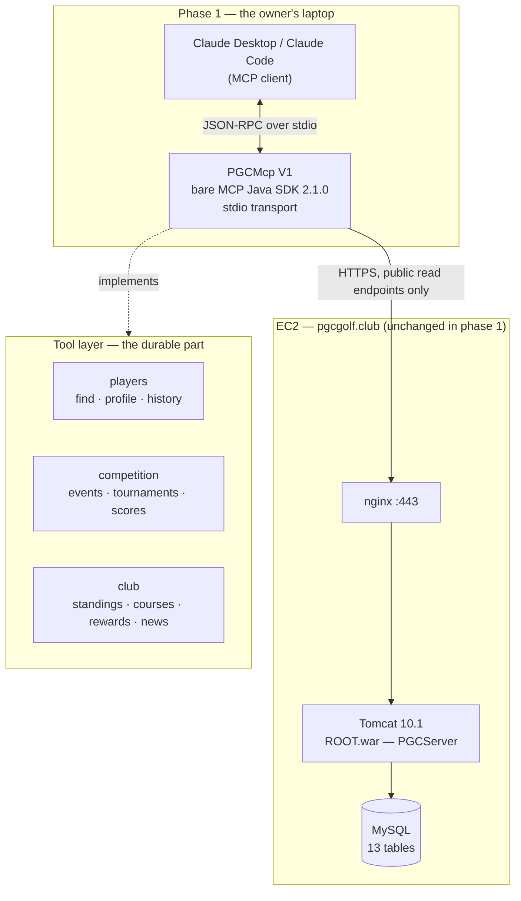
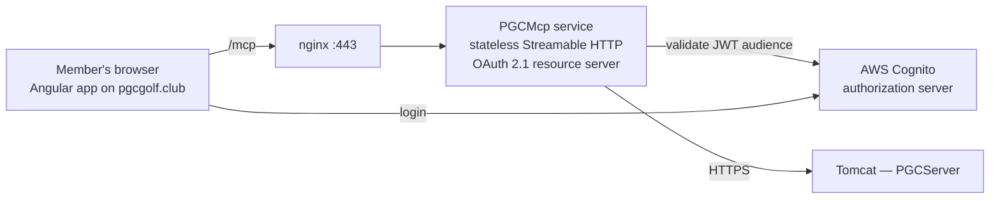
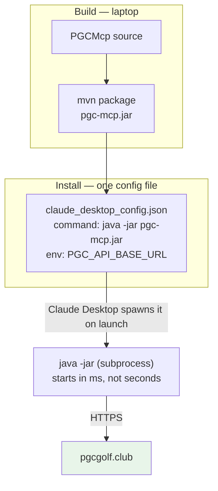
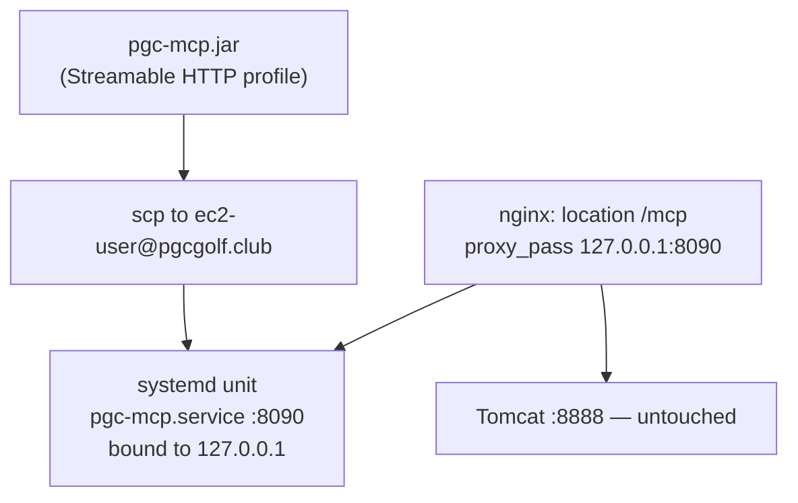

# PGC MCP Server — design

**Date:** 2026-10-29
**Status:** design for review, nothing built
**New artifact:** `PGCMcp` — a separate Maven project, not part of `PGCServer`

---

## 1. Intent

Let an AI assistant answer questions about the club from real data — "how has Yan Ou
scored this season", "who leads the PGC Cup", "what did the Crab Cup field shoot" — by
exposing the existing `pgcgolf.club` REST API as MCP tools.

Phase 1 is a **local, read-only** server for the owner's own Claude Desktop / Claude Code.
Phase 2 re-hosts the same tool layer for signed-in club members. The tool layer is the
durable asset; the transport and auth around it change between phases.

**There is a second, equally real purpose: learning MCP well enough to apply it
professionally.** That changes some engineering choices, and where the two goals conflict
this document favours learning and says so. §4a sets out the path.

## 2. Goals

- Ten or so task-shaped read tools covering scores, standings, handicaps, events,
  tournaments, players, courses, rewards and news.
- Answers grounded in live production data, with no new write paths.
- A tool layer written so that phase 2 is a transport swap, not a rewrite.
- A working understanding of the protocol itself — not of one SDK's conveniences —
  transferable to a different language and stack.

## 3. Non-goals

- Any write or admin capability (no event creation, no grouping, no score upload).
- MCP resources and prompts — tools only in phase 1.
- Replacing or changing the website.
- Chasing protocol revision `2026-07-28` in phase 1 (see §5).

## 4. Anti-goals — what would make this a failure even if it worked

- **Leaking member PII into an LLM context.** `/webapi/players` returns `phone` and
  `email` unmasked, while the web UI masks both for signed-out users
  (`edit-player.component.ts:46-47`). Only 1 phone and 2 emails are currently populated,
  so the present exposure is small — but a tool that passes player records through
  verbatim would send them to a model, and later to members. PII is stripped at the tool
  boundary, always.
- **Dumping the season into the context window.** `/webapi/points/game-scores` returns
  every current-season game with all 18 hole scores for ~146 player rows. One careless
  pass-through tool would spend a large fraction of the context on a single question.
- **Becoming a second, weaker copy of the API.** The MCP server holds no business logic
  and no database access. If an answer needs new computation, the computation belongs in
  `PGCServer` where it can be unit-tested, not in the tool layer.
- **Widening the existing write exposure.** Nine write endpoints are already
  unauthenticated (§5). Nothing here should make that easier to reach.

## 4a. Learning path — three implementations, deliberately uneven

The same server gets built three times, in this order. The point is that only the first
one is built in full.

| # | Stack | Why this one | Scope |
|---|---|---|---|
| **V1** | Bare `io.modelcontextprotocol.sdk:mcp` 2.1.0, no Spring | Java is the strongest language here, so the whole novelty budget goes on MCP rather than on syntax. No annotations and no auto-configuration, so the server, the stdio transport and tool registration are all written by hand and therefore seen. | **All 11 tools.** This is the real server. |
| **V2** | Spring Boot 4.1.2 + `spring-ai-starter-mcp-server` 2.0.2 | Shows what a framework hides: `@Tool` annotations, auto-configured transport, a dependency swap for Streamable HTTP. Most directly job-applicable in a Spring shop. | **2–3 tools only.** |
| **V3** | TypeScript SDK | The reference implementation: most mature, furthest along on `2026-07-28`, and where community examples and idioms live. The real jump — a different ecosystem, which is what proves the protocol knowledge is portable rather than Java-shaped. | **2–3 tools only.** |

**Why V2 and V3 are thin.** Learning from re-implementation is heavily front-loaded: V1
teaches most of it, and by V3 a full rebuild is mostly retyping. Two or three tools are
enough to feel how a framework or a different SDK treats the same protocol. Building all
eleven three times costs days and teaches little past the first few tools.

**Honest note on V2.** Bare Java SDK → Spring AI is the *smallest* of the two jumps: same
language, same ecosystem, same JSON library. Its value is job-applicability rather than
protocol insight. Java → TypeScript is where the understanding actually gets tested. If
time runs short, V2 is the one to drop.

### Two activities that teach more than another implementation

1. **Read the wire.** Run V1 under the MCP Inspector, or tee stdin/stdout to a file, and
   read an actual `tools/list` request and `tools/call` round trip. Probably the single
   highest-yield hour in the project — protocols do not click until the bytes have been
   read.
2. **Write a small client** (~100 lines, phase 1b). Almost everyone writes servers only,
   so the client half — version negotiation, tool discovery, how a result is handed to a
   model — is where most mental models are weakest. Writing it in TypeScript doubles as
   the V3 on-ramp.

### What transfers to a job, and what does not

Transfers: **tool design** (naming, granularity, when to summarise — collapsing 78
endpoints into 11 tools *is* that exercise); **authorization** (OAuth 2.1 resource server,
audience validation, why token passthrough is forbidden — phase 2); **statelessness** and
why the protocol moved there.

Does not transfer: SDK-specific APIs, annotation names, framework wiring.

### A current hazard

Revision `2026-07-28` removed sessions, the `initialize` handshake and HTTP+SSE. A large
share of MCP tutorials predate it and describe a protocol that no longer exists. Anything
mentioning `Mcp-Session-Id` or an initialize handshake is stale. Read the spec and its
changelog first.

## 5. Constraints and facts established before designing

**The API.** 78 endpoints across 12 controllers. Most reads are public, which is why a
read-only server needs no authentication at all.

**Authentication cannot be reused as-is.** `PGCServer` authenticates with Cognito
`oauth2Login` — a browser session cookie. An MCP server cannot perform an interactive
redirect, so every `/webapi/admin/**` endpoint is unreachable to it. This is the reason
phase 1 is read-only rather than merely a scoping preference.

**Pre-existing unauthenticated writes.** Outside `/webapi/admin/**`, and therefore
`permitAll`: `POST/PUT/DELETE /webapi/rewards`, `POST/PUT/DELETE /webapi/donations`,
`POST /webapi/players/ghin`, `POST /webapi/event/create/playerscores`. CSRF is disabled.
Not caused by this work and not fixed by it — but it should be closed before phase 2, and
certainly before any write tool exists.

**Protocol.** The current revision is `2026-07-28`, which removed sessions and the
`initialize` handshake, made the protocol stateless, requires `server/discover`, and
deprecated HTTP+SSE, Roots, Sampling, Logging and Dynamic Client Registration. Phase 1
deliberately targets whatever stable revision the chosen SDK speaks by default: Claude
Desktop negotiates it today, the new revision opens a twelve-month deprecation window
rather than breaking anything, and the TypeScript SDK's 2026 support is alpha and opt-in.
Phase 2 targets stateless Streamable HTTP properly.

**Toolchain, verified against Maven Central on 2026-10-29:**

| Artifact | Stable | Latest |
|---|---|---|
| `io.modelcontextprotocol.sdk:mcp` | 2.1.0 | 2.2.0-M1 |
| `org.springframework.ai:spring-ai-starter-mcp-server` | 2.0.2 | 2.1.0-RC1 |

V1 needs only `io.modelcontextprotocol.sdk:mcp:2.1.0`, which pulls `mcp-core` and
`mcp-json-jackson3` — no web framework, no Spring. V2 adds
`spring-ai-starter-mcp-server:2.0.2`, which depends on `spring-boot-starter:4.1.2`, whose
Java baseline is **17**. Local toolchain is Java 21.0.9 and Maven 3.9.12, so both work.
`PGCServer` stays on Boot 3.3.5 — the version gap is irrelevant because `PGCMcp` is a
separate artifact. I could not confirm that the Java SDK implements `2026-07-28`; phase 1
does not depend on it.

## 6. Decisions

| # | Decision | Whose |
|---|---|---|
| D1 | Phase 1 client is Claude Desktop / Claude Code, expanding later | user |
| D2 | Read-only | user |
| D3 | Eventual audience is signed-in members (phase 2) | user |
| D4 | Runs as its own service, not inside the `PGCServer` WAR | user |
| D5 | Java first, TypeScript later | user. Java is the strongest language here, so MCP is the only new variable; TypeScript follows to prove the knowledge is portable |
| D6 | Tools only; no resources or prompts | user |
| D7 | Phase 1 is **stdio**, deploying nothing; phase 2 introduces the EC2 service | mine — reconciles D1 with D4, which belong to different phases |
| D8 | **V1 uses the bare `io.modelcontextprotocol.sdk:mcp` 2.1.0 — no Spring** | **revised.** Originally the Spring AI starter, chosen for engineering convenience: phase 2 needs a web server and the starter makes that a dependency swap. But its annotations and auto-configuration hide the protocol, which defeats the learning goal added in §1. Spring AI becomes V2 instead. Also drops JVM startup from ~3s to milliseconds, which matters when the client spawns the process on every launch |
| D9 | Tools call the public REST API over HTTPS, never the database | mine — keeps one source of truth and avoids a second DB credential |
| D10 | PII stripped and payloads summarised at the tool boundary | mine — see §4 |
| D11 | Three implementations in order: bare SDK → Spring AI → TypeScript | user |
| D12 | Only V1 gets all 11 tools; V2 and V3 get 2–3 | mine — learning from re-implementation is front-loaded, so a full rebuild twice over costs days and teaches little past the first few tools |
| D13 | Phase 1b adds a ~100-line client, and V1 is run under the MCP Inspector | mine — the client half of the protocol is where understanding is usually thinnest, and reading the wire teaches more than a third server would |

## 7. System architecture

The tool layer is deliberately drawn apart from the transport: phase 2 replaces the stdio
box and adds auth, and leaves the tool layer alone.

**Phase 2, for context — not being built now:**

Note the rule the spec is explicit about: the member's token is validated **for** this
server and is **not** passed through to `PGCServer`. Any upstream call needs its own
credential.

## 8. Deployment

Phase 1 deploys nothing. The client launches the server as a subprocess.

No WAR rebuild, **no Tomcat restart, no site downtime** — which is the point of D4/D7.
The existing deploy restarts Tomcat and takes the site down for roughly ten seconds; MCP
iteration must not cost that.

Phase 2 deployment, when it comes:

Two properties worth keeping: the MCP service binds to loopback so only nginx can reach
it, and it restarts independently of Tomcat so the website never goes down for an MCP
release.

## 9. Tool catalogue

Names are `snake_case` and verb-led. All are read-only. Defaults are chosen so the common
call is cheap; detail is opt-in.

| Tool | Arguments | Backed by | Notes |
|---|---|---|---|
| `find_player` | `name` | `GET /webapi/players` | **Load-bearing.** A model has "Yan Ou", never `id=1000`, and there is no search endpoint. Fetches the list and matches locally on first/last/nickname, case- and accent-insensitively. Returns at most 10 candidates with `playerId`, name, handicaps. Every other player tool depends on this. |
| `get_player_profile` | `playerId` | `GET /webapi/players/{id}` | PII stripped. |
| `get_player_score_history` | `playerId`, `season?`, `includeHoles=false` | `GET /webapi/players/{id}/score-history` | Defaults to the current season, mirroring the website. Per-hole arrays only when asked. |
| `list_events` | `season?`, `status?`, `limit=10` | `GET /webapi/events` | Newest first. |
| `get_event_scores` | `eventId`, `playerName?`, `includeHoles=false` | `GET /webapi/points/game-scores/event/{id}` | Without `includeHoles` returns gross/net/points per player, not 18 columns. `playerName` narrows to one player. |
| `get_standings` | `limit=20` | `GET /webapi/points/standings` | PGC Cup points. |
| `list_tournaments` | `season?` | `GET /webapi/tournaments` | With round counts and date ranges. |
| `get_tournament_totals` | `tournamentId` | `GET /webapi/points/game-scores/tournament/{id}` | Combined gross and net across rounds. |
| `list_courses` | — | `GET /webapi/courses` | Name, par, rating, slope. |
| `get_event_rewards` | `eventId` | `GET /webapi/rewards?eventId=` | In display order. |
| `get_club_news` | `limit=5` | `GET /webapi/news` | Active news, newest first. |

Eleven tools against 78 endpoints. The admin half of the API is intentionally absent, and
several read endpoints are folded into the tools above rather than exposed one-to-one.

`tools/list` returns them in a stable order — the spec asks for deterministic ordering so
clients can cache and prompt caches can hit.

## 10. Response shaping

Three rules, applied in one place so they cannot be forgotten per-tool:

1. **Strip PII.** `phone` and `email` are removed from every player payload before it
   leaves the server. Not configurable in phase 1.
2. **Summarise by default.** Per-hole arrays, internal ids, null fields and unused
   columns are dropped unless a flag asks for them. Lists carry an explicit `limit` with
   a sane default.
3. **Say what was omitted.** When a list is truncated or holes were dropped, the response
   says so, so the model can ask for more instead of assuming it has everything.

## 11. Errors, configuration and testing

**Errors.** A tool returns a readable message, never a stack trace: unknown player id →
"No player with id 9999"; `find_player` with no match → the fact that nothing matched,
plus the closest names; upstream 5xx or timeout → that the club API is unreachable, with
the status. A failed tool call must never look like an empty result, or the model will
answer confidently from nothing.

**Configuration.** `PGC_API_BASE_URL` (default `https://pgcgolf.club`) from the
environment, per the spec's guidance that stdio servers take credentials from the
environment rather than running an OAuth flow. No secrets are needed in phase 1 because
every endpoint used is public. With the bare SDK there is no Spring property binding, so
this is read directly from `System.getenv` and validated at startup.

**Logging.** Nothing may be written to stdout — on a stdio transport stdout *is* the
protocol channel, and a stray `System.out.println` corrupts the stream. All logging goes
to stderr, which the spec permits and the client may surface. Worth knowing that
`PGCServer` is full of `System.out.println`; that habit would break this server.

**Testing.** Unit tests per tool against a mocked HTTP client, written first: argument
validation, the PII strip, the summarise-by-default behaviour, `find_player` matching
(exact, partial, case, no-match, more than ten matches), and error mapping. Plus one
temporary live-data check against production, run once and deleted, as with STEP42-45 —
because a mocked client cannot prove the real payloads parse. Candidate assertions:
`find_player("Yan Ou")` resolves to id 1000, and `get_player_score_history(1000)` returns
rounds whose Out + In reconcile to the stored gross.

## 12. Risks and open items

- **Java-first is now a considered choice, not a compromise.** My earlier recommendation
  of TypeScript assumed a single implementation. With V3 in the plan the concern mostly
  dissolves: Java starts where fluency is highest, and TypeScript arrives anyway. The
  residual risk is that the Java SDK trails the TypeScript one on new protocol revisions —
  which matters for phase 2, not phase 1.
- **Three implementations is a real time cost** even scoped as D12 describes. If something
  has to give, drop V2: it is the smallest jump and the least protocol insight per hour.
- **Java SDK support for `2026-07-28` is unconfirmed.** Irrelevant to phase 1, decisive
  for phase 2. Worth rechecking before that work starts.
- **Spring AI 2.1.0 is RC and the SDK's 2.2.0 is a milestone.** Phase 1 should pin the
  stable pair (`spring-ai-starter-mcp-server:2.0.2`).
- **The nine unauthenticated write endpoints** should be closed before phase 2.
- **`isPGC2025` naming.** Membership is keyed on a column named for 2025 with no 2026
  equivalent, and 19 players have it null. Any future membership-aware tool inherits that
  ambiguity.
